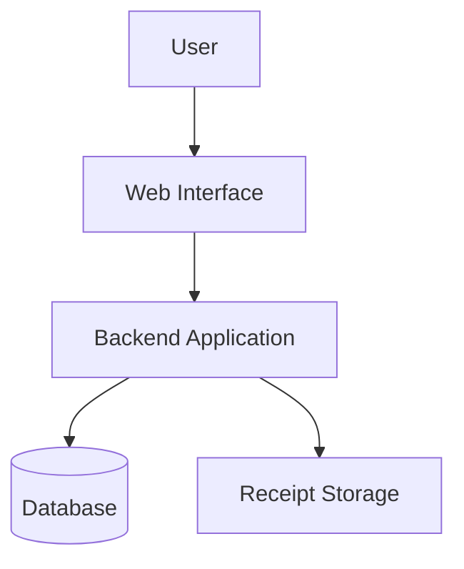

# FinSight – Personal Finance Platform

**A personal finance platform for tracking income and expenses, storing receipts and understanding spending habits.**

[Overview](#project-overview) · [Getting Started](#getting-started) · [Features](#key-features) · [Structure](#repository-structure) · [Roadmap](#limitations-and-future-improvements)

---

## Table of Contents

- [Project Overview](#project-overview)
- [At a Glance](#at-a-glance)
- [Objectives](#objectives)
- [Key Features](#key-features)
- [Getting Started](#getting-started)
- [Configuration](#configuration)
- [System Architecture](#system-architecture)
- [Repository Structure](#repository-structure)
- [Screenshots](#screenshots)
- [Technologies](#technologies)
- [Skills Demonstrated](#skills-demonstrated)
- [Limitations and Future Improvements](#limitations-and-future-improvements)
- [Author](#author)
- [License](#license)

---

## Project Overview

FinSight is a personal finance platform that helps a user keep track of their money in one place. It lets users record financial activity, attach receipt images to their records and review their spending.

The project combines:

- A backend application with a database for storing financial records
- Receipt upload and storage
- Environment-based configuration for secrets and settings
- Dashboards, charts, budgeting, categories or reports (keep only what you built)

---

## At a Glance

| | |
|---|---|
| **Purpose** | Personal finance tracking and insight |
| **Backend** | Python (Flask / Django / FastAPI) |
| **Database** | SQLite 
| **Frontend** | HTML + CSS + JavaScript / React / templates |
| **Receipts** | Uploaded files stored on the server (`static/uploads/receipts/`) |
| **Configuration** | `.env` file (a `.env.example` template can be committed) |
| **Status** | In development |

---

## Objectives

- Provide a simple way to record income and expenses.
- Keep receipts attached to the transactions they belong to.
- Give the user a clear view of where their money goes.
- Keep secrets and personal data out of version control.
- Budgets, goals, reports, multi-user support.

---

## Key Features

- **Transaction tracking:** add, edit and delete income and expense records.
- **Receipt uploads:** attach receipt images to transactions.
- **Categories:** group spending (food, transport, bills and so on).
- **Dashboard and charts:** summaries of spending over time.
- **Budgets and goals:** set limits and track progress.
- **User accounts:** sign up, log in and keep each user's data separate.

---

## Getting Started

### Requirements

| Requirement | Purpose |
|---|---|
| Python 3.x | Run the application |
| pip | Install dependencies |
| Git | Clone the repository |
| Node.js | Only if the project has a JavaScript build step |

### Installation

```bash
# 1. Clone the repository
git clone https://github.com/pradee-26/FinSight-Personal-Finance-Platform.git
cd FinSight-Personal-Finance-Platform

# 2. Create and activate a virtual environment
python -m venv venv
venv\Scripts\activate          # Windows
source venv/bin/activate       # Linux / macOS

# 3. Install dependencies
pip install -r requirements.txt     
```

### Run the application

```bash
# replace with your real start command, for example:
python app.py
# or: flask run
# or: python manage.py runserver
```

Then open `http://localhost:3000` (confirm the port) in your browser.

---

## Configuration

Settings and secrets live in a `.env` file, which is excluded from Git. Create one in the project root:

```env
SECRET_KEY=change-me
DATABASE_URL=sqlite:///finsight.db
```

> Never commit real keys or passwords. If a `.env.example` file exists, copy it to `.env` and fill in your own values.

The following are generated at run time and are intentionally **not** tracked by Git:

| Item | Reason |
|---|---|
| `.env*` (except `.env.example`) | Secrets and local settings |
| `instance/`, `*.db`, `*.sqlite`, `*.sqlite3` | Local databases |
| `static/uploads/` (including receipts) | User-uploaded files and personal data |
| `venv/`, `.venv/`, `__pycache__/` | Local environment and Python cache |
| `node_modules/`, `build/`, `dist/`, `coverage/` | Build and dependency output |

---

## System Architecture



Authentication, categories, analytics, reports.

---

## Repository Structure

```text
FinSight-Personal-Finance-Platform/
├── FinSight/         
├── .gitignore
└── README.md
```

open the `FinSight/` folder on GitHub and list its main files and folders here, with a short comment on each.

---


## Technologies

| Technology | Use in this project |
|---|---|
| Python | Backend application |
| Web framework | Routing, views and APIs |
| Database | Storing transactions and users |
| HTML / CSS / JavaScript | User interface |
| Git and GitHub | Version control and hosting |

---

## Skills Demonstrated

- Full-stack application development
- Database design for financial records
- File upload handling for receipts
- Secure configuration with environment variables and `.gitignore`
- Authentication, charts, REST APIs, testing (keep what applies)

---

## Limitations and Future Improvements

### Current limitations

For example, single-user only, no automated tests, receipts are not read automatically.

### Possible future improvements

- Automatic reading of receipt data (OCR)
- Budget alerts and savings goals
- Charts and monthly reports
- Export to CSV or PDF
- Automated tests and a CI workflow
- Deployment instructions for a hosted version

---

## Author

**PRADEEBA R S**

- GitHub: [@pradee-26](https://github.com/pradee-26)
- Repository: [pradee-26/FinSight-Personal-Finance-Platform](https://github.com/pradee-26/FinSight-Personal-Finance-Platform)

---

## License

No license has been selected for this repository yet, so reuse terms are not defined. To state reuse terms, add a `LICENSE` file at the repository root (on GitHub: **Add file → Create new file**, name it `LICENSE` and choose a template).
